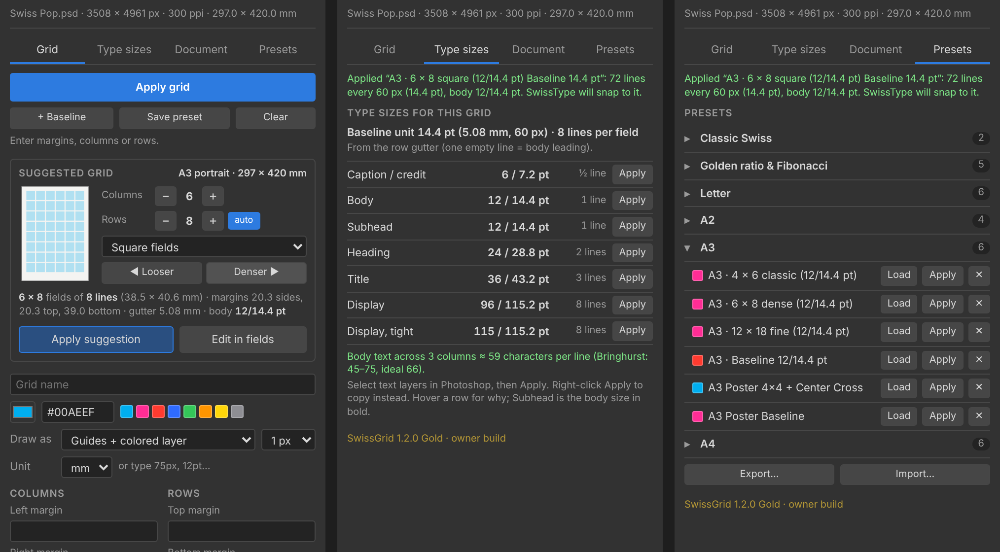
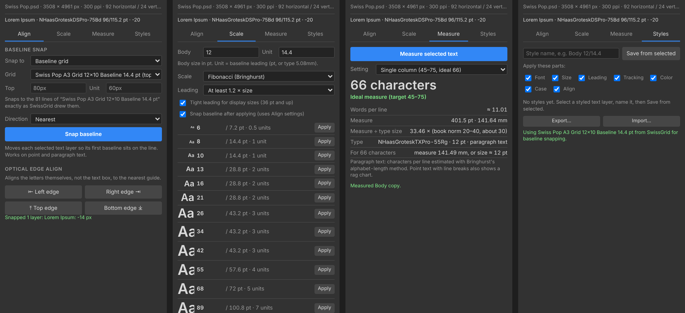

# Swiss Photoshop Tools

**SwissGrid** and **SwissType**: two Photoshop panels for designing in the Swiss / International Typographic Style. Build Müller-Brockmann grids in any color, get grid suggestions for any canvas, set type sizes that lock to the grid, and snap every baseline exactly into place.

Built by Joseph Martinez (J.A.M.), grounded in Josef Müller-Brockmann's *Grid Systems in Graphic Design* and Robert Bringhurst's *The Elements of Typographic Style*.

**Current version: 1.2.0 Gold** (owner build, no license key). See [CHANGELOG.md](CHANGELOG.md).

| | |
|---|---|
| Photoshop | CC 2019 to 2026 (versions 20 to 27), including Photoshop 2022 (23.x) |
| Systems | Windows and macOS |
| Type | Dockable HTML panels (Adobe CEP), opened from **Window > Extensions (legacy)** |
| Needs | No Creative Cloud app, no UXP Developer Tool, no Adobe installer |

---

## SwissGrid



SwissGrid is organized in four tabs so every control stays near the top of the panel: **Grid**, **Type sizes**, **Document** and **Presets**.

### Grid tab: build a grid

- **Apply grid** at the top, with **+ Baseline**, **Save preset** and **Clear** right below it.
- **Live preview line** under the buttons: the grid you're about to draw (for example `6 col × 38.5 mm · 8 row × 40.6 mm · 30 lines`), or exactly what's wrong in plain language ("Columns don't fit: 12 columns of 23.00 mm plus 11 gutters of 2.03 mm need 298.35 mm, but there's only 288.54 mm between the margins...").
- **Grid name and color** for every grid: color picker, hex field and 8 quick swatches.
- **Draw as:**
  - **Guides + colored layer** (default): real guides for snapping, plus the grid drawn in its color on a locked layer named `SwissGrid · <grid name>`.
  - **Colored layer only.**
  - **Guides only.** On Photoshop 2023 and later the guides themselves take your color. Photoshop 2022 and earlier only have one global guide color, which is why the colored layer exists.
- **Line thickness:** 1 to 4 px for the colored layer.
- **Units:** mm, px, in, cm, pt or % (of the canvas). Any field also accepts its own unit, for example `15.24mm`, `75px`, `1in`, `12pt`, `5%`.
- **Unit switching converts your numbers.** Change the unit and every margin, width, height and gutter is rewritten exactly (15.24 mm becomes 180 px at 300 ppi). Switching back and forth never drifts. **Keep the numbers instead** puts back what you typed if it was meant for the new unit.
- **Columns and rows:** left/right and top/bottom margins, count, width or height, gutter, position (left/center/right, top/middle/bottom) and a midpoint guide. Leave width or height blank and SwissGrid calculates it.
- **Exact fitting:** grids that are off by a pixel or less because of unit rounding are fitted exactly instead of rejected.
- **Grids stack.** Change the measurements and color and apply again: every grid keeps its own color and layer.
- **Single undo.** Every apply, remove and clear is one History step (Ctrl+Z / Cmd+Z).

### Grid tab: Suggested grid for this canvas

For when you don't know where to start.

- **Recognizes the canvas:** A0 to A6, B4, B5, Letter, Legal, Tabloid, square, and screen sizes (Instagram square and portrait, Story/Reel, Full HD, 4K), in portrait or landscape. Anything else is treated as a custom size.
- **Looser / Denser:** step from 1 up to 12 columns. Rows follow automatically, or set them yourself with Rows −/+ (**auto** goes back to automatic).
- **Field shape:** **Square**, **Golden tall** (1 : 1.618), **Golden wide** (1.618 : 1) or **Fibonacci** (columns step through 1, 2, 3, 5, 8; margins, rows and lines per field favour Fibonacci numbers).
- **Calculated the Swiss way:** the body size comes from the canvas (A4 9 pt, A3 12 pt, A2 18 pt...), one baseline line is the body leading (1.2 × body), and margins, gutters (one empty line) and field heights are all whole lines. Left-over space goes to the bottom margin, the heaviest margin.
- **Thumbnail preview** of the page with the fields drawn in your grid color.
- **Specs:** fields × lines per field, field size in mm, margins (sides, top, bottom), gutter and body size/leading.
- **Apply suggestion** draws it. **Edit in fields** loads it into the form to fine-tune first.

### Type sizes tab

- **Reads the grid's baseline unit:** from a baseline grid's row height, or a field grid's row gutter (one empty line), or by splitting gutterless rows into whole lines, or estimated from the canvas.
- **Recommended sizes and leading** locked to that unit: **Caption / credit**, **Body**, **Subhead**, **Heading**, **Title**, **Display** and **Display XL** (or **Display, tight**: one line per field, set solid).
- **One-click Apply:** select one or more text layers in Photoshop, click **Apply** on a row, and the size and leading are set on every selected text layer (other layers are skipped). Right-click Apply to copy the value instead.
- **Measure check:** how many columns body text should span for 45 to 75 characters per line (Bringhurst), with a warning when it's outside that range.
- **+ Baseline (Grid tab)** adds the baseline grid that matches these sizes: one line per body leading, from the top of the first field to the bottom of the last, in its own color.

### Document tab

- **Every grid on this document,** with its color, top and line height (for example `top 80 · line 60 px`).
- **Hide / Show** a grid's colored layer, or **Remove** its guides and layer.
- **Clear all grids:** every guide and every SwissGrid layer in the document.
- **Copy diagnostics:** panel size, screen scaling and Photoshop details for troubleshooting.

### Presets tab

- **Grouped and collapsible:** Classic Swiss, Golden ratio & Fibonacci, Letter, A2, A3, A4, A5 and My presets. The group for the open canvas opens automatically.
- **Built in:**
  - **Classic Swiss:** 6×6 Square Swiss Grid, Text Baseline 6×6.
  - **Golden ratio & Fibonacci:** Golden Section Divisions (any canvas), Golden Textblock A4, Fibonacci A4, A3 and Letter.
  - **Letter, A2, A3, A4, A5:** a classic 4-column, a dense 6-column and a fine 12-column grid for each, plus the matching baseline, all with their body size in the name (for example `A3 · 4 × 6 classic (12/14.4 pt)`). Plus the A3 Poster 4×4 + Center Cross, A4 4×5 and Letter 4×5 grids and their baselines.
- Paper presets are in mm, so they work at any resolution.
- **Load** (into the form), **Apply** (draw now) or **✕** (delete). **Save preset** keeps your own under My presets.
- **Export / Import** presets as a JSON file to share or back up.

### Works with SwissType

Every grid you apply is saved inside the .psd and in a small shared file on your computer, so SwissType can snap text to it, including the calculated baseline for a field grid you haven't drawn a baseline for.

---

## SwissType



All the typography helpers in one panel: **Align**, **Scale**, **Measure** and **Styles**.

### Align tab

- **Baseline snap:** moves each selected text layer so its **first baseline** sits exactly on a line. Works on point and paragraph text.
  - **Snap to:** the nearest horizontal guide, or a **baseline grid**.
  - **Grid menu:** every grid SwissGrid applied to this document, plus the **calculated baseline** for field grids. SwissType picks the baseline grid automatically; Top and Unit fill in and lock. Quick choices and a custom Top/Unit (any unit) are there too.
  - **Direction:** Nearest, Up only or Down only.
- **Optical edge align:** aligns the letters themselves, not the text box, to the nearest guide: **Left**, **Right**, **Top** or **Bottom** edge.
- **Copy diagnostics:** what SwissType measured for the selected text (Photoshop version, text type, position, bounds, calculated baseline, grid lines), for troubleshooting.

### Scale tab

- **Type scales:** Fibonacci (Bringhurst), Traditional 6–72, Golden ratio 1.618, Perfect fifth, Perfect fourth and Major third, from your body size.
- **Leading in whole baseline units** (minimum 1.15, 1.2 or 1.3 × size), with optional tight leading for display sizes (36 pt and up).
- **Apply** a size to the selected text layers, and optionally **snap the baseline afterwards**.

### Measure tab

- **Characters per line** using Bringhurst's alphabet-length copyfitting, with a single-column (45–75, ideal 66) or multi-column (40–50) target.
- Words per line, measure in pt and mm, measure ÷ type size, and the measure (or size) you'd need for 66 characters.
- Point text with line breaks also gets a rag chart.

### Styles tab

- **Save a style** from a selected layer: font, size, leading, tracking, color, case and alignment.
- **Apply** it to other layers, choosing which parts to apply, **Update** it, or delete it.
- **Export / Import** styles as a file.

---

## Install

1. Download or clone this repository.
2. Windows: double-click `SwissGrid/Install-SwissGrid.bat` and `SwissType/Install-SwissType.bat`.
   macOS: right-click `Install-SwissGrid-Mac.command` (and SwissType's) > **Open** > **Open**.
   Each installer allows your own unsigned panels for your user (`PlayerDebugMode = 1` for CSXS 9 to 12) and copies the panel to your extensions folder (`%APPDATA%\Adobe\CEP\extensions` on Windows, `~/Library/Application Support/Adobe/CEP/extensions` on macOS).
3. Quit and reopen Photoshop.
4. Open **Window > Extensions (legacy) > SwissGrid** (and **SwissType**). Dock them or leave them floating.

They appear under **Window > Extensions (legacy)**, not the **Plugins** menu: Photoshop's Plugins menu only lists UXP plugins.

To update, run the installer again: it replaces the old copy. To remove, run the matching `Uninstall-*` file.

**Gold owner build:** `python release/build_release.py --gold` builds `Swiss-Tools-GOLD-<version>.zip` with licensing switched off (no key, no expiry).

### Troubleshooting

- **Panel missing from Window > Extensions (legacy):** run the installer again and restart Photoshop. Remove any older SwissGrid/SwissType folders in `C:\Program Files (x86)\Common Files\Adobe\CEP\extensions` or `C:\Program Files\Common Files\Adobe\CEP\extensions`, which can override the new one.
- **Bottom of a panel cut off, no scrollbar (Windows with 125% or 150% display scaling):** a Photoshop bug with this panel type. The tabs keep everything near the top. If something is still hidden, float the panel and resize it, or set Windows display scaling to 100% before opening Photoshop.
- **Grid lands in the wrong place:** reset the ruler origin (double-click where the rulers meet).
- **Before exporting artwork:** hide or remove the SwissGrid layers.

---

## Selling later (Gumroad)

The release builder also makes the Gumroad downloads (SwissGrid, SwissType and the Swiss Bundle) with license keys checked against Gumroad's license API: a SwissGrid or SwissType key unlocks its panel, a Bundle key unlocks both, keys work on up to 3 computers, re-check monthly and work offline for 14 days. Fill in `release/release_config.json` and run `python release/build_release.py`. This is switched off in the Gold build.

---

## How it's built

Adobe CEP panels: HTML, CSS and JavaScript for the interface, ExtendScript for the Photoshop side.

```
SwissGrid/
  Install-SwissGrid.bat / -Mac.command, Uninstall-*, README.md
  SwissGrid/
    CSXS/manifest.xml     panel definition (Photoshop 20+, CSXS 9+, Node enabled)
    index.html, css/panel.css
    js/grid.js            grid math (margins, columns, rows, gutters, units)
    js/typeRec.js         type sizes from the grid's baseline unit
    js/suggest.js         canvas detection and grid suggestions
    js/gridstore.js       grids shared with SwissType
    js/cepfix.js          scrolling that works in every CEP version
    js/license.js         Gumroad licensing (off in Gold builds)
    js/panel.js           the panel
    jsx/host.jsx          Photoshop side: guides, colored layers, type, metadata
SwissType/
  Install-SwissType.bat / -Mac.command, Uninstall-*, README.md, readme.txt
  SwissType/              same structure; js/type.js holds the type-scale math
release/
  build_release.py, release_config.json, QUICK-START.txt
docs/images/              screenshots
```

---

© Joseph Martinez / Exclusive ETC, LLC. All rights reserved. Private repository.
