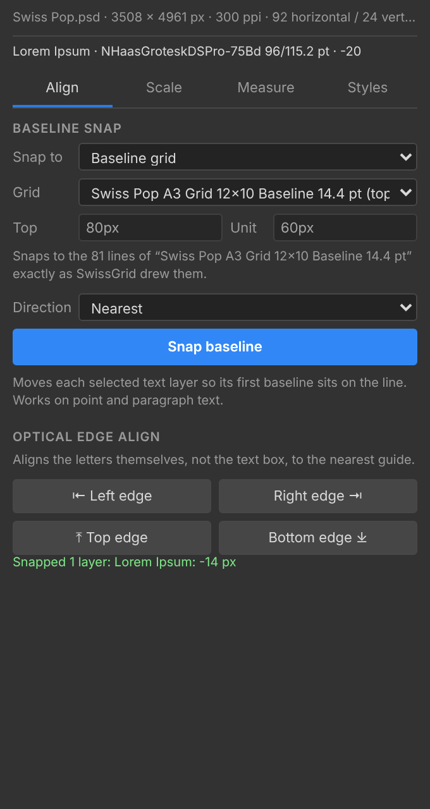
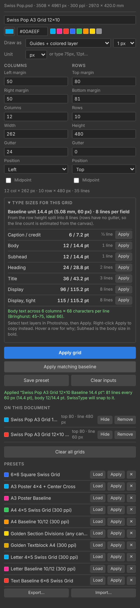

# Swiss Photoshop Tools

**SwissGrid** and **SwissType**: two Photoshop panels for designing in the Swiss / International Typographic Style. Build Müller-Brockmann grids in any color, get type sizes that lock to the grid, and snap every baseline exactly into place.

Built by Joseph Martinez (J.A.M.) for his own poster work, grounded in Josef Müller-Brockmann's *Grid Systems in Graphic Design* and Robert Bringhurst's *The Elements of Typographic Style*.

Runs as dockable panels in **Photoshop CC 2019 through 2024 on Windows, including Photoshop 2022**. No Creative Cloud desktop app, UXP Developer Tool or Adobe installer needed.

---

## Better together: SwissType auto-aligns to your SwissGrid

This is the feature Photoshop never had. Select any text layers, click once, and every first baseline lands exactly on your grid.



1. **SwissGrid saves the grid inside your .psd.** Every grid you apply is stored in the document, with its exact line positions.
2. **SwissType finds it on its own.** The Align tab reads those grids and picks the baseline grid automatically. In the screenshot, *Swiss Pop A3 Grid 12×10 Baseline 14.4 pt* is picked with no setup: 81 lines, exactly as SwissGrid drew them.
3. **One click snaps everything you selected.** **Snap baseline** moves each selected text layer, point or paragraph, so its first baseline sits on the nearest line (or the next line up or down). Each layer reports how far it moved, for example *Lorem Ipsum: -14 px*.
4. **Then align the letters, not the box.** **Optical edge align** moves the visible type itself onto the nearest column guide, so a headline's first letter sits exactly on the margin.
5. **One Ctrl+Z undoes it all.** Each snap is a single history step.

Without it, you'd nudge each text box by eye and check it at 400% zoom. With both panels, every block of type on the poster shares one baseline rhythm.

<br clear="right">

## SwissGrid

A GuideGuide-style grid builder where **every grid gets its own color** and grids stack.



- **Grids in any unit:** margins, columns, rows, widths and gutters in mm, px, in, cm, pt or %. Switch units and every field converts in place, exactly, with no rounding drift.
- **Per-grid colors:** each grid is drawn as guides plus a locked, colored layer, so a blue field grid and a red baseline grid can sit on the same canvas. (Photoshop 2022 can only color guides globally, so the colored layer does the job; on 2023+ the guides take the color too.)
- **Type sizes for this grid:** reads the grid's baseline unit and recommends Caption, Body, Subhead, Heading, Title and Display sizes whose leading lands on whole lines, plus how many columns body text should span for a 45 to 75 character measure (Bringhurst).
- **One-click Apply:** select text layers and click Apply on any role to set size and leading.
- **Apply matching baseline:** builds the baseline grid that belongs to your field grid, one line per body leading, from the top of the first field to the bottom of the last.
- **Presets:** 6x6 square, A3 poster, A4 and Letter (with baselines), golden section divisions and a golden textblock. Save, load, export and import your own.
- **Clean history:** every apply, remove and clear is a single Ctrl+Z.
- **Grids saved in the file:** each applied grid is stored inside the .psd so SwissType can find it.

<br clear="right">

## SwissType

All the typography helpers in one panel, built to work with SwissGrid.


- **Align: Baseline snap.** Moves each selected text layer so its first baseline sits exactly on a line. The Grid menu lists the grids SwissGrid applied to this document and picks the baseline grid automatically.
- **Align: Optical edge align.** Aligns the letters themselves, not the text box, to the nearest guide.
- **Scale: Type scale.** Traditional or Fibonacci (Bringhurst) scales with leadings in whole baseline units; Apply sets size and leading and can snap to the baseline afterward.
- **Measure: Measure checker.** Characters per line using Bringhurst's alphabet-length copyfitting, words per line, and the measure you'd need for 66 characters.
- **Styles: Text styles.** Save font, size, leading, tracking, color, case and alignment from a layer and reapply them anywhere. Export and import as files.

## Install (Windows)

Each tool installs the same way:

1. Download or clone this repository.
2. Open `SwissGrid/` (or `SwissType/`) and double-click **Install-SwissGrid.bat** (or **Install-SwissType.bat**). It allows your own unsigned panels for your Windows user (`PlayerDebugMode = 1` under `HKCU\Software\Adobe\CSXS.9` to `CSXS.12`) and copies the panel to `%APPDATA%\Adobe\CEP\extensions\`.
3. Restart Photoshop.
4. Open **Window > Extensions (legacy) > SwissGrid** (or **SwissType**) and dock it wherever you like.

Uninstall with the matching `Uninstall-*.bat`. Full instructions are in [SwissGrid/README.md](SwissGrid/README.md), [SwissType/README.md](SwissType/README.md) and [SwissType/readme.txt](SwissType/readme.txt).

## UXP versions (Photoshop 2023 and later)

Adobe is phasing out CEP panels in Photoshop: the Marketplace stops taking new CEP plugins in March 2027, and Photoshop turns them off by default in December 2027. So both tools also come as **UXP plugins**, which you install through Creative Cloud and which can be sold on the Adobe Marketplace:

- [SwissGrid/SwissGrid-UXP/](SwissGrid/SwissGrid-UXP/) (`com.jam.swissgrid`, v2.0.0)
- [SwissType/SwissType-UXP/](SwissType/SwissType-UXP/) (`com.jam.swisstype`, v2.0.0)

They need Photoshop 24.2 (2023) or later. Each has the same features as its CEP panel and saves grids in the .psd the same way, so SwissType UXP snaps to grids from either version of SwissGrid. Style and preset files export and import across both versions.

**Try one in Photoshop:** install Adobe's **UXP Developer Tool** from the Creative Cloud app, click **Add Plugin**, pick the folder's `manifest.json`, then **Load**. The panel appears under **Plugins > SwissGrid** (or **SwissType**).

**Package for the Marketplace:** in UXP Developer Tool, choose **Package** to build a `.ccx` file, then upload it in the Adobe Developer Distribution portal. Before listing, replace the placeholder plugin ID with the ID the portal assigns, and add 23/46 px panel icons and 24/48 px plugin icons in light and dark versions.

UXP files: `manifest.json`, `index.html`, `css/panel.css`, and `js/`. The `js/` folder holds the same grid and type math as the CEP panels, `host.js` (the Photoshop side, using `batchPlay` and the UXP DOM), and `panel.js`.

## A typical workflow

1. **SwissGrid:** apply a field grid (for example 12 columns x 10 rows on A3), then click **Apply matching baseline**.
2. **SwissGrid:** select your headline and click **Apply** on Display; select body copy and click **Apply** on Body.
3. **SwissType > Align:** Snap to *Baseline grid* (your SwissGrid baseline is already picked) and click **Snap baseline**. Then **Left edge** so the letters sit exactly on the margin.
4. **SwissType > Measure:** check the body measure lands between 45 and 75 characters.
5. Hide the SwissGrid layers before exporting your artwork.

## How it's built

Both tools are Adobe CEP panels: HTML, CSS and JavaScript for the interface (`index.html`, `css/`, `js/`) and ExtendScript for the Photoshop side (`jsx/host.jsx`). Grid math lives in `SwissGrid/SwissGrid/js/grid.js`, type recommendations in `js/typeRec.js`, and type-scale math in `SwissType/SwissType/js/type.js`.

```
SwissGrid/
  Install-SwissGrid.bat, Uninstall-SwissGrid.bat, README.md
  SwissGrid/            the panel (CSXS/manifest.xml, index.html, css, js, jsx)
SwissType/
  Install-SwissType.bat, Uninstall-SwissType.bat, README.md, readme.txt
  SwissType/            the panel
docs/images/            screenshots
```

---

© Joseph Martinez. All rights reserved. Private repository.
